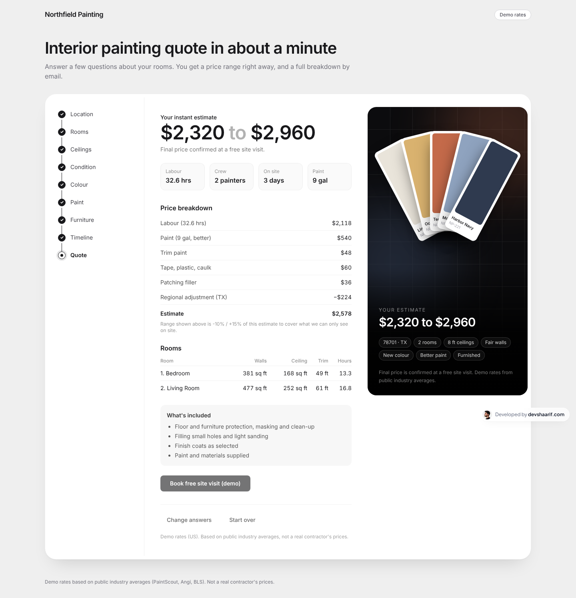
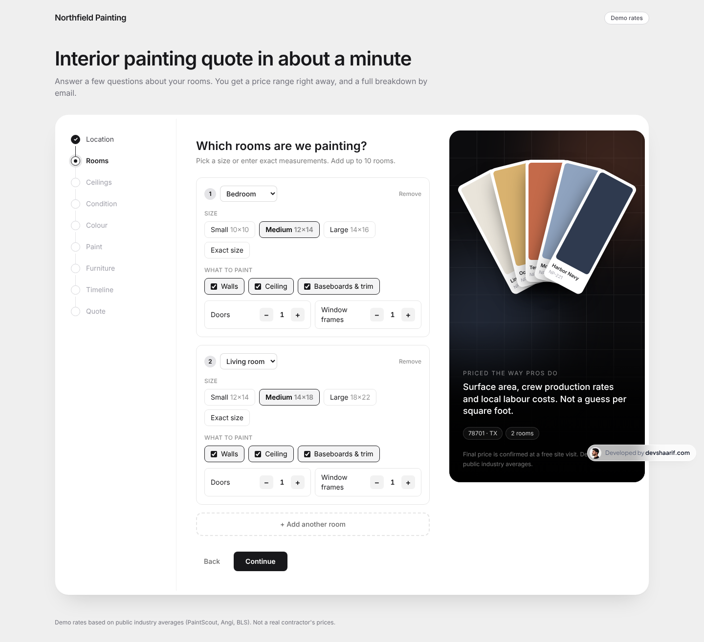
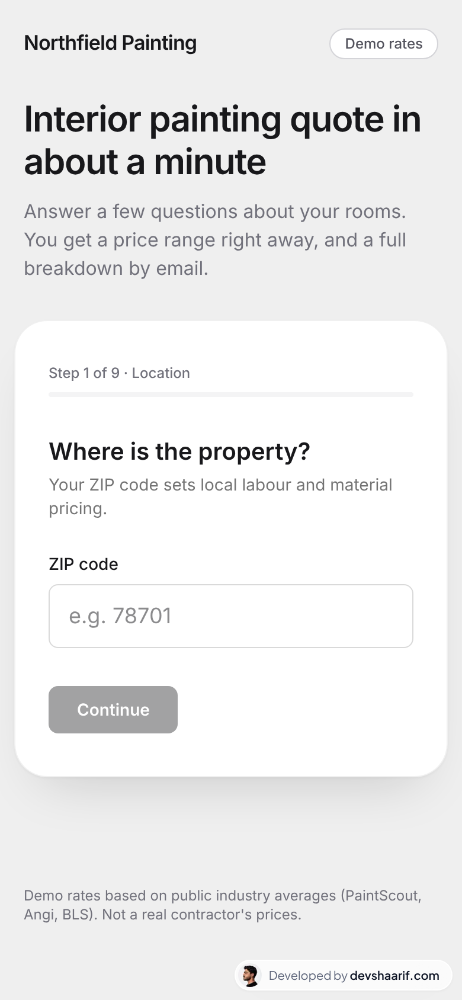

# Painting Instant Quote

An instant interior painting quote tool for contractors. The homeowner answers a short quiz and gets a realistic price range in about a minute, priced the way painters actually estimate: surface area, crew production rates, labour hours, paint by coverage and local labour costs.



> **Demo rates.** The company (Northfield Painting) is fictional and the prices are demo rates built from public industry averages. They are not a real contractor's prices. Sources are listed below.

**Live demo:** coming soon

## The problem

Most painting company websites have a "Get a free quote" form that goes nowhere fast. The homeowner fills it in, waits a day or two for a call back, and often books whoever answers first. The few sites with a calculator use a flat price per square foot, which is either too cheap (and the contractor loses money) or too high (and the lead leaves).

Pro estimating software uses a better method (production rates), but it lives inside the contractor's back office. The homeowner never sees it.

## What it does

1. **Quiz, one question per step:** ZIP code, rooms (type, size, walls, ceiling, trim, doors, windows), ceiling height, wall condition, colour change, paint quality, furniture, timeline.
2. **Prices it like a pro:** each surface is divided by a crew production rate to get labour hours, then multiplied by the condition, height, colour and furniture factors.
3. **Works out the job:** labour hours, crew size (1 or 2 painters), days on site, gallons of paint and primer.
4. **Adds materials and local pricing:** paint by coverage plus waste, trim paint, sundries, patching, materials markup, then a regional factor by state from the ZIP code.
5. **Shows a range, not a fake exact number:** -10% / +15% around the estimate, with "final price confirmed at a free site visit", the same pattern the big roofing quote tools use.
6. **Contact gate:** the range is shown first. Name and email unlock the full line-item and room-by-room breakdown.

Coming next: lead saved to Google Sheets, branded PDF quote by email, automatic follow-up.



## How the pricing works

```
wall area    = perimeter x wall height - 20 sq ft per door - 15 sq ft per window
hours        = walls/90 + ceiling/80 + trim/20 + doors x 1.25 + windows x 0.5
hours        = hours x condition x ceiling height x colour change x furniture
               + 2 hrs setup/clean-up per job + 0.5 per extra room
labour       = hours x billable rate
paint        = ceil(area x coats / 350 x 1.10)
materials    = (paint + primer + trim paint + sundries + patching) x 1.20
total        = (labour + materials) x regional factor   (minimum job applies)
range        = total x 0.90  to  total x 1.15
crew         = 1 painter up to 21 hrs (3 days solo), else 2
```

The pricing engine is plain TypeScript with no AI in it, so the same answers always give the same price. A contractor changes one file (`src/lib/quote/rates.ts`) to use their own rates.

## Demo rate sheet

| Item | Demo value | Source |
|---|---|---|
| Walls / ceilings / trim | 90 sq ft/hr, 80 sq ft/hr, 20 lin ft/hr | PaintScout |
| Door, window frame | 1.25 hr, 0.5 hr each | PaintScout |
| Painter median wage | $23.75/hr (May 2025) | BLS |
| Billable rate | $65/hr (about $27 loaded cost / 40% labour share) | PaintScout method |
| Paint coverage | 350 sq ft/gallon | Angi |
| Paint Good / Better / Best | $35 / $50 / $70 per gallon | Angi |
| Primer | $20/gallon | Angi |
| Drywall repair (poor walls) | $300 allowance | Angi |
| Regional factor | CA 1.43, NY 1.24, FL 1.03, TX 0.92 and others | Angi state averages vs national |
| Multipliers, markup, minimum job | see `rates.ts` | Demo assumptions |

Sanity check: a 12 x 15 ft bedroom with ceiling, trim, a door and 2 windows comes out at $1,234 to $1,576 (fair walls, furnished). Angi puts the average room repaint at about $1,100, with a typical range of $400 to $1,600.

Sources:
- [PaintScout: Don't guess on pricing](https://www.paintscout.com/guides/post/dont-guess-on-pricing)
- [Angi: How much does it cost to paint a room](https://www.angi.com/articles/how-much-does-it-cost-paint-bedroom.htm)
- [BLS: Painters, construction and maintenance](https://www.bls.gov/ooh/construction-and-extraction/painters-construction-and-maintenance.htm)

## Stack

- Next.js 16 (App Router), React 19, TypeScript
- Tailwind CSS 4
- Vitest for the pricing engine tests
- Vercel for hosting

## Run it locally

```bash
git clone https://github.com/devshaarif2030/painting-instant-quote.git
cd painting-instant-quote
npm install
npm run dev      # http://localhost:3000
npm test         # pricing engine tests
```

No API keys are needed for the quote itself.

## Project structure

```
src/lib/quote/rates.ts        demo rate sheet with sources
src/lib/quote/engine.ts       pricing engine (hours, crew, days, materials, range)
src/lib/quote/zip.ts          US ZIP to state, for the regional factor
src/lib/quote/engine.test.ts  tests, including the worked examples above
src/components/QuoteWizard.tsx  quiz and result screen
```

## Mobile



## License

MIT. Built by [Muhammad Shaarif](https://devshaarif.com).
